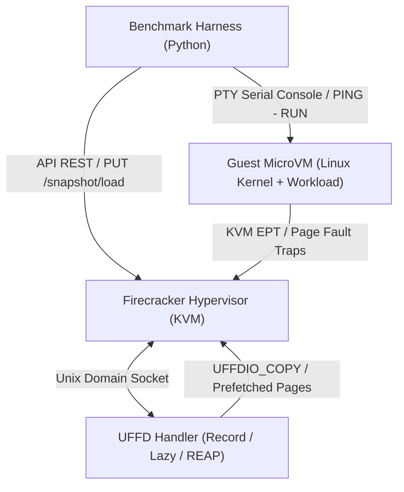
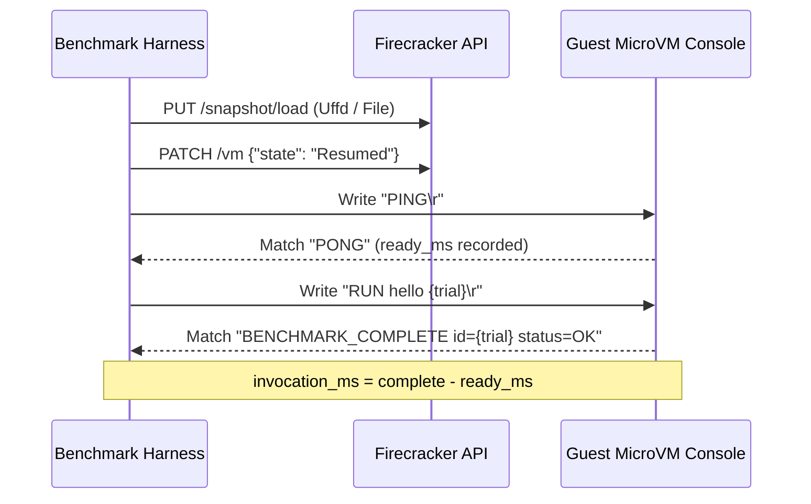

# Architecture & Technical Methodology

This document outlines the system architecture and memory management mechanics used in this research.

---

## System Architecture

---

## Memory Management Paradigms

| Strategy | Memory Backend | Cold Start Mechanics | Trade-offs |
| :--- | :--- | :--- | :--- |
| **File-backed Snapshot** | `File` (`vm_memory`) | Backed by file on host filesystem. Linux kernel demand-pages on access. | Fast startup, but consumes large host disk bandwidth and RAM across multi-tenant instances. |
| **Lazy UFFD** | `Uffd` (`/tmp/fc-reap-handler.sock`) | Zero pages loaded upfront. Page faults trap to userspace UFFD daemon. | Instant microVM startup, but severe execution penalty (+548% latency) due to context switches. |
| **REAP (Record & Prefetch)** | `Uffd` (`/tmp/fc-reap-handler.sock`) | **Phase 1 (Record):** Log accessed pages to `working_set_offsets.txt`. **Phase 2 (Prefetch):** Issue bulk `UFFDIO_COPY` calls before resuming the guest. | Eliminates page-fault storms during invocation while retaining low baseline memory footprint. |

---

## Synchronization Protocol (Active Handshake)

To eliminate timing jitter caused by arbitrary sleep delays, the benchmark harness enforces a strict serial synchronization protocol:

